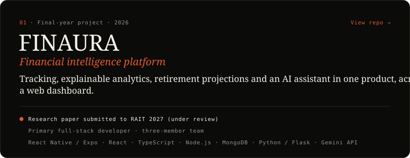
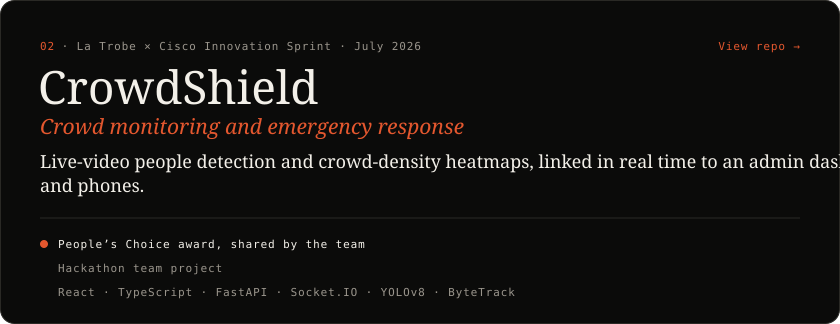
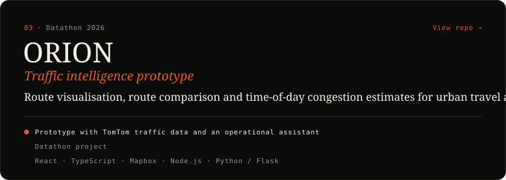
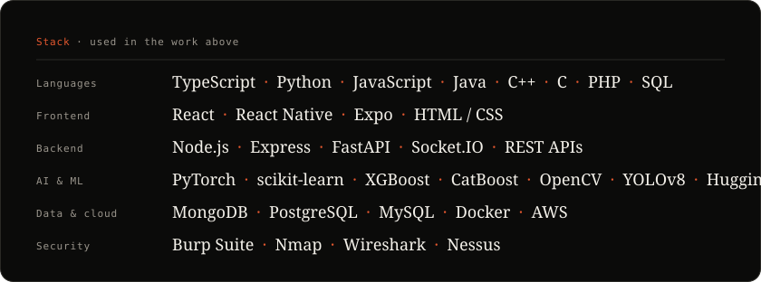

<a href="https://www.parthpalav.xyz">parthpalav.xyz</a> &nbsp;·&nbsp; <a href="https://www.linkedin.com/in/parthpalav/">LinkedIn</a> &nbsp;·&nbsp; <a href="mailto:parth.s.palav@gmail.com">Email</a>

